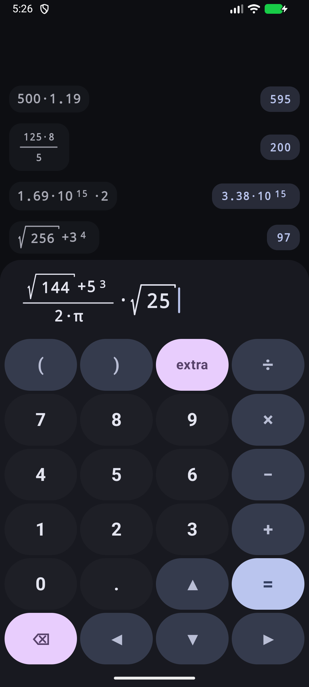
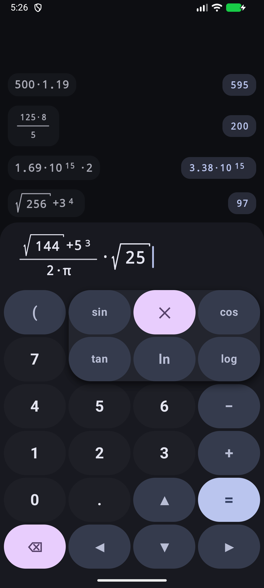
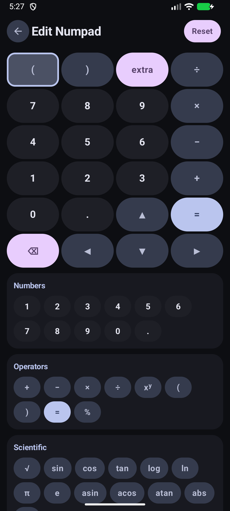
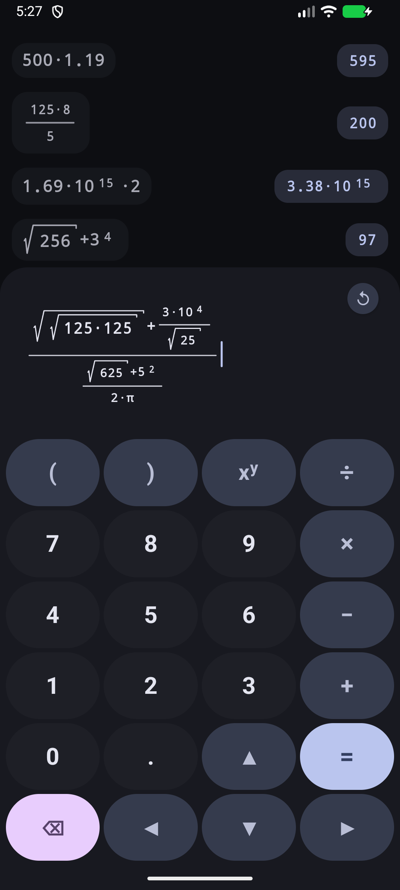

<div align="center">
  
</div>

# MECalculator

A modern, expressive calculator for Android built with Material 3 Expressive and dynamic Material You the whole way through. Natural 2D visual math input (fractions, powers, roots, functions) with arbitrary-precision calculation powered by EvalEx. Designed with fluid squircle-morphing keypad buttons, infinite 2D gesture navigation, and interactive history traversal.

## Screenshots

<table>
  <tr>
    <td align="center"></td>
    <td align="center"></td>
    <td align="center"></td>
    <td align="center"></td>
  </tr>
</table>

## Features

- **Natural 2D Math Editor**: True mathematical typesetting with nested fractions, powers, square roots, and functions — no clunky linear ASCII syntax.
- **Interactive 2D Viewport**: Pan, pinch-to-zoom, and auto-framing on large equations with smooth 2D cursor traversal across numerators, denominators, and exponents.
- **Arbitrary-Precision Arithmetic**: High-precision evaluation delegated to EvalEx — exact results with customizable trailing decimal places and LaTeX-style scientific notation ($a \cdot 10^{\text{exp}}$).
- **Interactive Calculation History**: Smooth pull-down history with separately selectable formulas and answers, responsive inline/stacked rendering, and instant copy-over to the editor.
- **Customizable Keypad**: Reorder keys, configure slots, and group trigonometric, mathematical, and constant functions into folders.
- **Material 3 Expressive & Material You**: Dynamic color theming, fluid squircle/pill shape morphing on press, full edge-to-edge layout, and snappy predictive back gestures.

## Build and Run

> All release APKs provided on the GitHub Releases page are built entirely in the open by GitHub Actions.

### Release Build (Manual)

If you want to compile the production release yourself, run:

```bash
./gradlew assembleRelease
```

The compiled APK will be output to `app/build/outputs/apk/release/app-release.apk`.

### Automated Screenshots

To capture the README screenshots deterministically in dark mode at 1080x2400:

```bash
make screenshots
```

If no device or emulator is running, the script automatically boots a headless emulator, sets standard density and dimensions, captures each view, and restores device settings upon exit.

## License

This project is licensed under the GNU Affero General Public License v3.0 (AGPL-3.0). See the [LICENSE](LICENSE) file for details.
